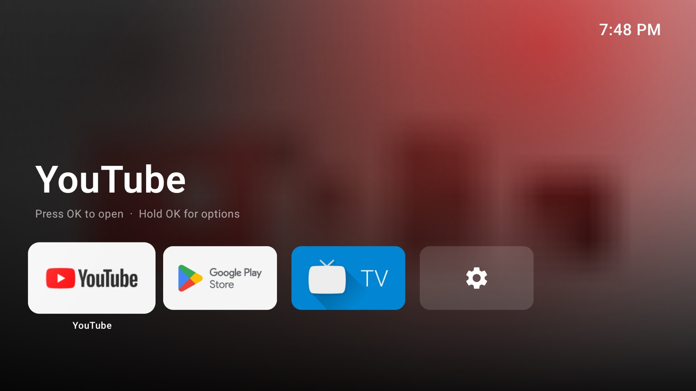

# Shelf

An Apple TV–style home screen for Google TV and Android TV. It's calm, fast and ad-free, and built for
the Chromecast with Google TV. Written in Kotlin with Jetpack Compose for TV.
Website: https://hayatayubi.github.io/shelf-tv



**Shelf collects nothing.** It doesn't even ask for internet access (see the [privacy note](PRIVACY.md)).

## Features

- **Top Shelf**: the focused app's name, large, over a soft colour wash taken from its own artwork.
- **Your favourites first**: the top row holds the apps you use most. Every other app sits in a grid below, and
  moving down slides the Top Shelf away, just like tvOS.
- **Tiles that feel like Apple TV**: a lift, a sheen and the app's name when focused.
- **Hold OK on any app** to open, move (it wiggles; drag it with the D-pad), hide, see App Info or uninstall it.
- **Back or Home** always jumps straight to the top.
- **Built for slow sticks**: each app's backdrop is drawn once, so nothing redraws while the screen is still.
- **No ads, no recommendations, no account.**

## Install on the TV

Shelf isn't on the Play Store. You install it with the free **Downloader** app:

1. On the TV, install **Downloader** (by AFTVnews) from the Play Store.
2. Allow it to install apps: *Settings → Apps → Security & restrictions → Unknown sources → Downloader*.
3. Open Downloader and enter `hayatayubi.github.io/shelf-tv/get` (it always gives the newest version).
4. Choose **Install**. Shelf appears in your apps.

### Making Shelf your Home screen

Google TV keeps its own home screen in charge of the Home button, so there are two ways to put Shelf there:

- **On the TV (no computer):** go to *Settings → System → Accessibility → Shelf Home Button* and turn it on. Pressing
  Home, or anything that opens the Google TV home screen, now brings you to Shelf.
- **With a computer (most reliable):** this swaps the home screen properly, and you can undo it any time. You need
  `adb` and *Wireless debugging* turned on in the TV's developer options.

  ```sh
  git clone https://github.com/hayatayubi/shelf-tv && cd shelf-tv
  ./scripts/install.sh <tv-ip>:<port>     # installs the latest Shelf and makes it Home
  ./scripts/restore.sh <tv-ip>:<port>     # puts the Google TV home screen back
  ```

The Home button has to come from a remote paired with the streaming device itself. If your TV's own remote controls it
over HDMI, the TV keeps its Home button for its own menus, and no app can change that.

## Updating

Install the new version the same way, with Downloader and the same address. Your app order and hidden apps are kept.

## Build

Requires JDK 17 and the Android SDK (`platforms;android-35`).

```sh
./gradlew assembleRelease    # app/build/outputs/apk/release/app-release.apk
```

Judge smoothness on release builds: debug Compose builds stutter on a Chromecast.

Your own builds are signed with the debug key, so they can't install over a published release (which uses the
maintainer's key). Uninstall the release first.

## Releasing

Bump `versionCode` and `versionName` in `app/build.gradle.kts`, add the version to [CHANGELOG.md](CHANGELOG.md), commit,
then run `./scripts/release.sh`. It builds and signs the APK, tags the version and publishes a GitHub Release with
`shelf.apk` attached, so the website's `/get` address picks it up straight away.
